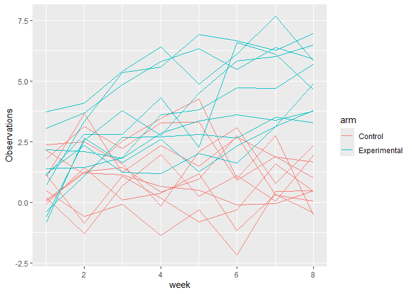

p8105_hw5_jem2315
================
Julian Morales
2026-11-15

## Problem 1

``` r
birthday_prob = function(x) {
  
  y = sample(1:365, size = x, replace = TRUE)
  
  duplicate = any(duplicated(y))
  
  return(duplicate)
  
}

#Function check
birthday_prob(10)
```

    ## [1] FALSE

``` r
birthday_prob(200)
```

    ## [1] TRUE

``` r
# Plot function
birthday = tibble(
  group_size = 2:50
) |> 
  mutate(
    probability = 
      map(group_size, ~mean(replicate(10000, birthday_prob(.x))) 
  ) |> unlist()
)

birthday |> 
  ggplot(aes(x = group_size, y = probability)) + 
  geom_point()
```

<!-- -->

The plot above describes the relationship between the size of a group of
randomly selected individuals and the probability that there are at
least 2 people within that group that will share a birthday. The plot
was built using a function that sampled n between 1 and 365 days for a
group of x size, and returns whether there are duplicate values or not,
then simulating this function over 10000 times for group sizes between 2
and 50 individuals. The resulting plot shows a sigmoid (s-shaped) curve
where as group size increases, the probability of 2 or more people
having the same birthday increases and levels off at the high end.

## Problem 2

``` r
subject_files = tibble(
  name = list.files(path = "data", full.names = TRUE)
) |>
  mutate(
    data = map(name, read_csv),
    arm = case_when(
      str_detect(name, "con_") ~ "Control",
      str_detect(name, "exp_") ~ "Experimental"
    ),
    subject_id = basename(name) |>
      str_replace("con_", "") |>
      str_replace("exp_", "") |>
      str_replace(".csv", "")
  )|>
  unnest(cols = data) |>
  pivot_longer(
    cols = starts_with("week"),
    names_to = "week",
    values_to = "observation"
  ) |>
  mutate(
  week = as.numeric(str_replace(week, "week_", "")),
  subject_id = paste(arm, subject_id, sep = "_")
  ) |>
  select(subject_id, arm, week, observation)

subject_files |> 
  ggplot(aes(x = week, y = observation, group = subject_id, color = arm)) + 
  geom_line() + 
  labs(x = "week", y = "Observations")
```

<!-- -->

The spaghetti plot above shows observations on each subject over time
between each arm of treatment (experimental vs control). Based on the
plot,
