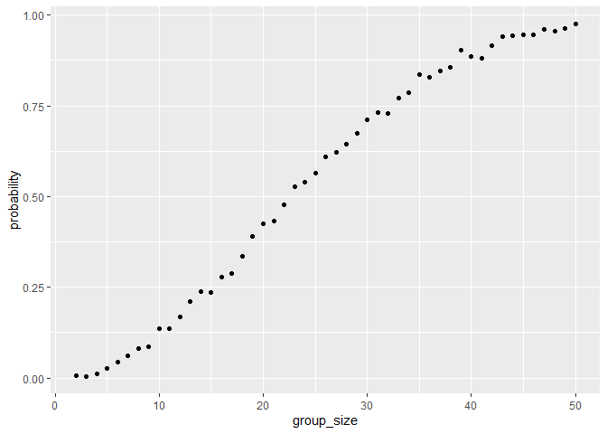

p8105_hw5_jem2315
================
Julian Morales
2026-11-15

## Problem 1

``` r
birthday_prob = function(x) {
  
  y = sample(1:365, size = x, replace = TRUE)
  
  duplicate = any(duplicated(y))
  
  return(duplicate)
  
}

#Function check
birthday_prob(10)
```

    ## [1] FALSE

``` r
birthday_prob(200)
```

    ## [1] TRUE

``` r
# Plot function
birthday = tibble(
  group_size = 2:50
) |> 
  mutate(
    probability = 
      map(group_size, ~mean(replicate(1000, birthday_prob(.x))) 
  ) |> unlist()
)

birthday |> 
  ggplot(aes(x = group_size, y = probability)) + 
  geom_point()
```

<!-- -->

## Problem 2

Create a tidy dataframe containing data from all participants, including
the subject ID, arm, and observations over time:

Start with a dataframe containing all file names; the list.files
function will help Iterate over file names and read in data for each
subject using purrr::map and saving the result as a new variable in the
dataframe Tidy the result; manipulate file names to include control arm
and subject ID, make sure weekly observations are “tidy”, and do any
other tidying that’s necessary Make a spaghetti plot showing
observations on each subject over time, and comment on differences
between groups

``` r
subject_files = tibble(
  name = list.files(path = "data", full.names = TRUE)
) |>
  mutate(
    data = map(name, read_csv),
    arm = case_when(
      str_detect(name, "con_") ~ "Control",
      str_detect(name, "exp_") ~ "Experimental"
    ),
    subject_id = basename(name) |>
      str_replace("con_", "") |>
      str_replace("exp_", "") |>
      str_replace(".csv", "")
  )|>
  unnest(cols = data) |>
  pivot_longer(
    cols = starts_with("week"),
    names_to = "week",
    values_to = "observation"
  ) |>
  mutate(
  week = as.numeric(str_replace(week, "week_", ""))
  ) |>
  select(subject_id, arm, week, observation)

#subject_files |> 
 # ggplot(aes(x = ))
```
